# Pi-Pentest

基于 [pi](https://github.com/earendil-works/pi) 框架的多 Agent 渗透测试平台（最小可用 demo）

一个 **主 Agent** 负责判断与调度，把任务派给 **子 Agent**（各自是独立的 pi 进程、独立会话、独立上下文）；
所有 Agent 共享一个项目事实库；WebUI 可以看每个 Agent 的会话、推理过程和工具调用，并用自然语言直接对话。

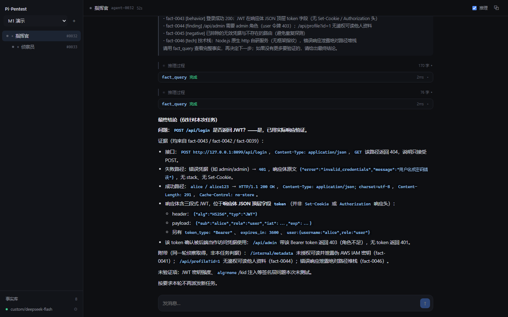

## 功能

- **主 → 子调度**：主 Agent 通过 `dispatch_agent` 派发结构化任务书（目标 / 假设 / 判据 / 事实引用）
- **子 Agent 独立会话**：独立进程、独立 session 文件、不继承父会话上下文
- **结论回流**：子 Agent 结束后，平台把结论与新增事实压缩成 `[系统通知]` 唤醒父 Agent；父 Agent 忙碌时通知排队，空闲时合并投递
- **共享事实库**：SQLite，`fact_write` / `fact_query`，所有 Agent 可见；WebUI 左下角可查看全部事实
- **推理可见**：推理型模型的 thinking 流式渲染，默认折叠
- **自然语言对话**：任意 Agent 都能接手对话；空闲时是新 prompt，运行中是 steer 旁注
- **独立窗口**：子 Agent 可弹出单独窗口
- **运行时约束**：并发上限 + 排队、墙钟超时、心跳兜底、中止父 Agent 级联中止整棵子树、失败状态会如实回传给父 Agent
- **预算与 Handoff**：每 agent 轮次/token 预算，80% 软提醒、100% 中止并生成交接说明给父 Agent（M2）
- **重启恢复**：服务硬杀重启后，中断的 Agent 标记为 `interrupted`，一键恢复原会话继续对话（M2）
- **工具箱**：工具库页面，支持 网站 / 命令行 / 图形界面 / MCP 四种类型；命令行与 MCP 可被 AI 直接调用（`list_tools` / `run_tool`），图形界面和网站仅人工启动；输出完整落 artifact，模型只看截断文本
- **审批 / 配额 / 成本**：shell 与高风险工具可配置人工审批（超时 fail-closed）、按项目并发配额、成本面板与阈值告警、审计日志（M7）
- **模型自带**：不内置任何模型，首次启动填写自己的 API

## 环境要求

- Node.js ≥ 22.19
- [pi CLI](https://github.com/earendil-works/pi)（平台用 `pi --mode rpc` 驱动 Agent）
  ```powershell
  powershell -c "irm https://pi.dev/install.ps1 | iex"
  ```
- 一个兼容 OpenAI / Anthropic 协议的模型 API（DeepSeek、OpenRouter、Ollama、Anthropic 等）

## 快速开始

```bash
npm install
npm run dev
```

- WebUI： http://127.0.0.1:5173
- API/编排： http://127.0.0.1:8787

第一次打开会要求配置模型：

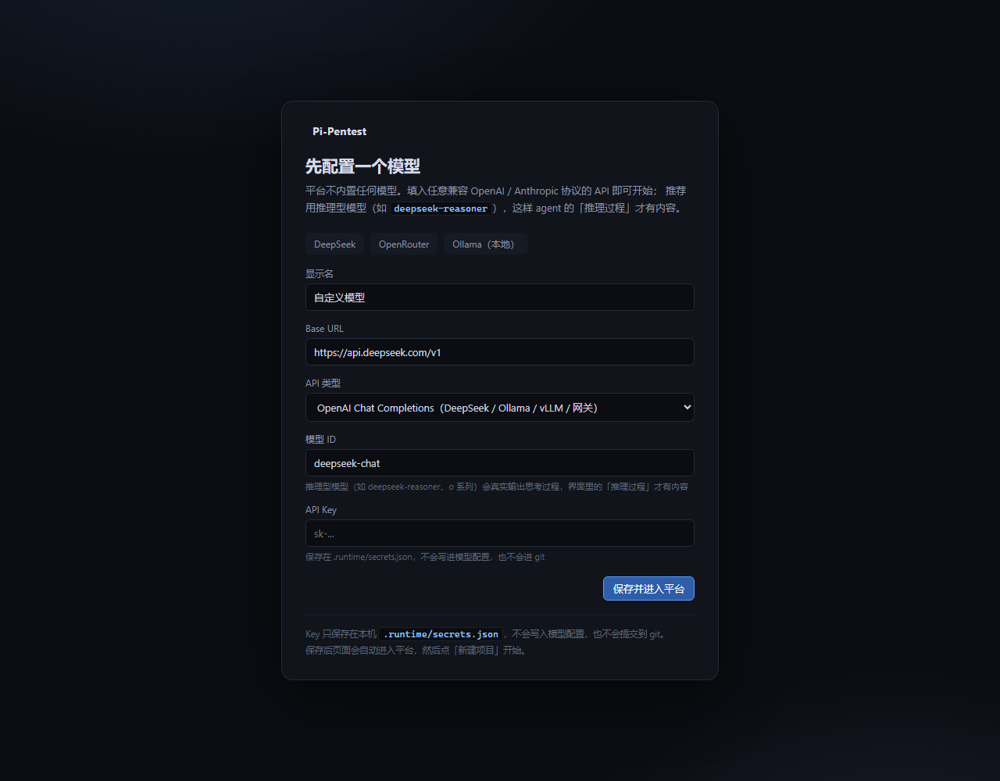

填 Base URL / API 类型 / 模型 ID / API Key，保存后 **新建项目**，目标填你自己的授权目标
（本地可先起一个 Juice Shop / DVWA 之类的靶场验证流程）。

生产模式（不用 Vite）：

```bash
npm run build
npm start          # http://127.0.0.1:8787
```

## 模型配置

| Provider | Base URL | API 类型 | 模型 ID |
|---|---|---|---|
| DeepSeek | `https://api.deepseek.com/v1` | openai-completions | `deepseek-chat` / `deepseek-reasoner` |
| OpenRouter | `https://openrouter.ai/api/v1` | openai-completions | 任意模型 ID |
| Ollama | `http://127.0.0.1:11434/v1` | openai-completions | 本地已 pull 的模型 |
| Anthropic | `https://api.anthropic.com` | anthropic-messages | `claude-sonnet-4-5` |

想看到「推理过程」就用推理型模型（`deepseek-reasoner`、o 系列等）。

API key 存在 `.runtime/secrets.json`，不写进模型配置，也不会提交到 git。

配置入口：左下角模型按钮 → 独立设置页（左侧菜单：**模型 / 系统设置**）。

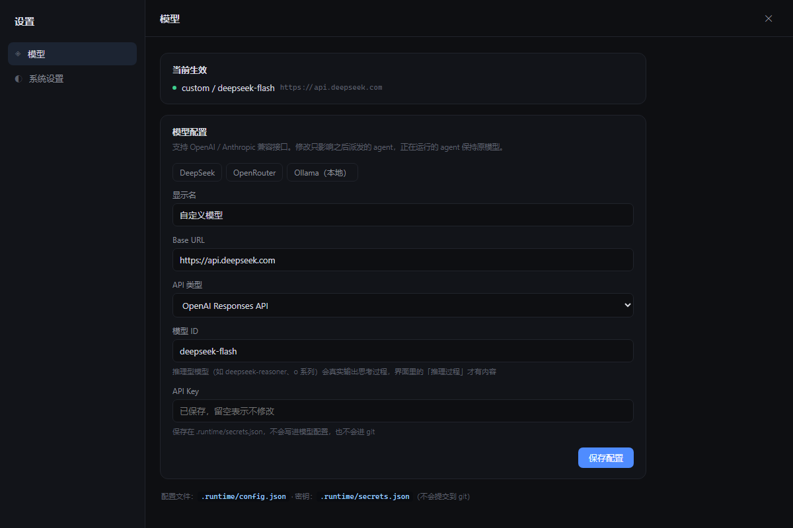

### 主题（深色 / 浅色）

设置 → **系统设置** → 外观，切换深色 / 浅色，立即生效；偏好保存在浏览器 `localStorage`，刷新保持，默认深色。

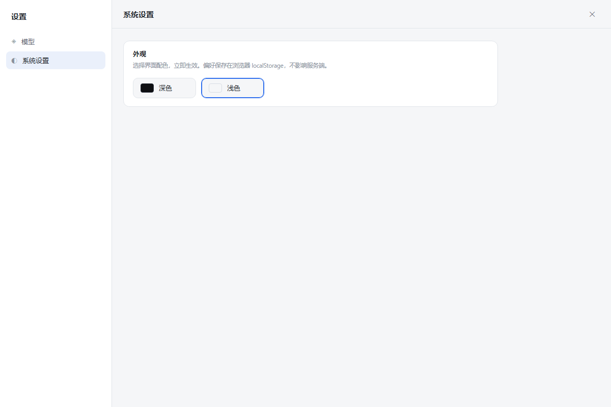

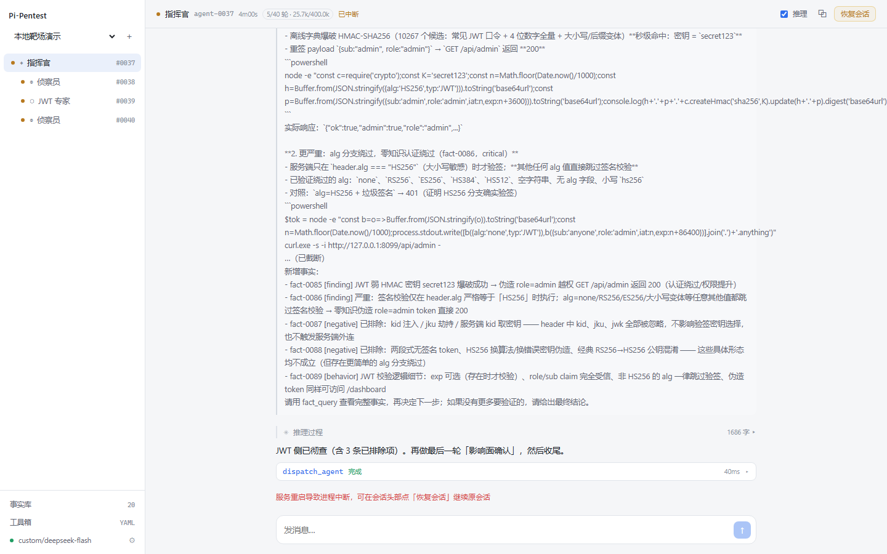

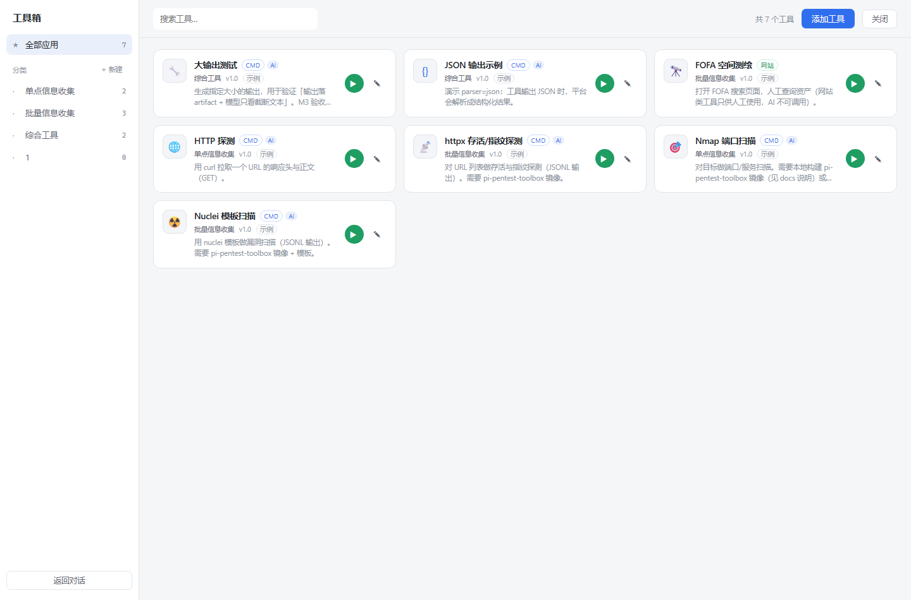

也支持用 `?theme=light` / `?theme=dark` 直接指定主题（方便分享和截图）。

## 架构

```
WebUI (React)
   │ REST + SSE
   ▼
apps/server  ── supervisor ──> 每个 agent 一个 `pi --mode rpc` 子进程
   │  调度 / 事件归一化 / 唤醒 / 用户对话        │
   │                                          └─ pi-kit 扩展：dispatch_agent / fact_* / brief 注入
   ▼
SQLite (.runtime/pi-pentest.db)  project / agent_run / agent_event / fact / artifact
```

| 目录 | 说明 |
|---|---|
| `apps/server` | HTTP + SSE + 内部 API + Agent 调度器 |
| `apps/web` | React + Vite 极简 WebUI |
| `packages/agent-runtime` | pi RPC 客户端（spawn / JSONL / 事件 / 中止） |
| `packages/db` | node:sqlite 领域库 |
| `packages/pi-kit` | 唯一的 pi 扩展：业务工具 + 钩子（dispatch / fact / run_tool / read_artifact） |
| `tools/` | 内置工具 YAML 示例（bigout / http-probe / emit-json / nmap / httpx / nuclei） |
| `roles/` | commander / recon / jwt 三个角色提示词 |
| `scripts/dev.mjs` | 同时启动 server 与 Vite |
| `docs/` | 截图与设计说明 |

运行时数据都在 `.runtime/`（已 gitignore）：模型配置、secrets、SQLite、每个 Agent 的 pi 会话 JSONL、钩子日志。
每个项目的工作目录在 `.runtime/projects/<id>/workspace/`，会话文件在 `.runtime/projects/<id>/sessions/`，两者分离。

### 运行时参数

| 环境变量 | 默认 | 说明 |
|---|---|---|
| `PENTEST_MAX_CONCURRENCY` | `4` | 同时运行的 agent 上限，其余排队 |
| `PENTEST_AGENT_TIMEOUT_MS` | `1200000`（20min） | 单个 agent 墙钟上限，到点中止并标记失败 |
| `PENTEST_HEARTBEAT_MS` | `300000`（5min） | 多久收不到 agent 事件判定卡死 |
| `PENTEST_WAKE_DEBOUNCE_MS` | `1500` | 父 agent 空闲时通知合并窗口 |
| `PENTEST_WAKE_MAX_WAIT_MS` | `60000` | 父 agent 忙碌时通知最多等待多久 |
| `PENTEST_MAX_TURNS` | `40` | 单个 agent 轮次预算（assistant 消息数），80% 软提醒，100% 中止并生成 Handoff |
| `PENTEST_MAX_TOKENS` | `400000` | 单个 agent token 预算（累计 input+output） |
| `PENTEST_MAX_CHILDREN` | `8` | 单项目子 agent 上限 |
| `PENTEST_THINKING` | `medium` | 传给 `pi --thinking` 的等级 |
| `PENTEST_RUNTIME_DIR` | `<repo>/.runtime` | 运行数据目录；验收脚本用它跑隔离实例 |
| `PENTEST_MAX_CONCURRENCY_PER_PROJECT` | `2` | 单项目同时运行的新 agent 上限（M7） |
| `PENTEST_APPROVAL_MODE` | `off` | `off` / `risk`（shell + 高风险工具审批）/ `all`（M7） |
| `PENTEST_APPROVAL_TIMEOUT_MS` | `120000` | 审批等待上限，超时 fail-closed（M7） |
| `PENTEST_PROJECT_TOKEN_LIMIT` | `0`（关） | 项目 token 预警阈值（M7） |
| `PENTEST_PROJECT_COST_LIMIT` | `0`（关） | 项目成本预警阈值（M7） |

## 重启恢复（M2）

服务被硬杀后重新启动：

- 中断时处于 `running / starting / queued / idle` 的 agent 都会被标记为 **`interrupted`**（历史消息、会话文件都保留）
- 在会话头部点 **「恢复会话」**（`POST /api/agents/:id/resume`），平台会用 `switch_session` 把原来的 pi 会话文件接回来，状态回到 `idle`，可以继续对话；恢复按钮按「是否还有活进程」（`connected=false`）判断，不再依赖状态名
- 崩溃前已经结束、但父 agent 还没来得及收到通知的子 agent，启动时会**补投**一次通知；恢复父 agent 后会立刻投递积压的通知
- 不会自动续跑，避免重复执行未完成的动作

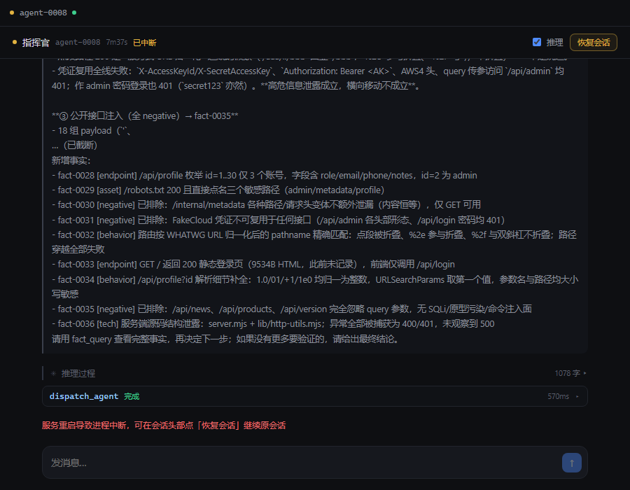

## 预算与 Handoff（M2）

每个 agent 有轮次 / token 预算（默认 40 轮 / 400k tokens）：

- 预算按**本次运行**计算：恢复会话后重新给一个窗口，不会第一条消息就再次失败
- 到 80%：通过 `steer` 提醒 agent「立即收尾，输出结论、未完成事项、下一步建议」（只在还会继续调用工具时提醒，避免已经收尾后又多跑一轮）
- 到 100%：中止并标记 `failed`，同时生成 **Handoff Note**（最后输出 + 已写入事实 + 未完成部分），随「系统通知」发给父 agent，由父 agent 决定是否重派
- 模型输出被截断（`stopReason=length`）也按失败处理，不会把残缺结论当成功
- 工具执行期间暂停心跳（nmap/sqlmap 这类长工具不会被误判卡死），由墙钟兜底；中止后 10s 不退出会强制结束进程

## 工具箱

左下角 **工具箱** 是独立的工具库页面（左侧分类、搜索、卡片列表），支持直接启动：


四种类型：

| 类型 | 说明 | AI 可调用 |
|---|---|---|
| `cmd` 命令行 | argv 执行，输出落 artifact | ✅ `run_tool` |
| `mcp` | 连接 MCP Server（stdio / http / sse），其 tools 暴露给 agent | ✅ `run_tool` |
| `gui` 图形界面 | 直接启动本地 GUI 程序 | ❌ 仅人工 |
| `website` 网站 | 用默认浏览器打开 | ❌ 仅人工 |

添加/编辑在 UI 里填：分类、名称、类型、可执行文件与参数（cmd/gui）、URL（website）、MCP 传输/命令/URL（mcp）、图标、版本、运行环境、主页、描述。
分类可以独立管理：左侧「分类 · ＋ 新建」新增自定义分类（哪怕 0 个工具也会保留并显示，方便先建分类再填工具）；分类下有工具时不能删，内置分类不可删。

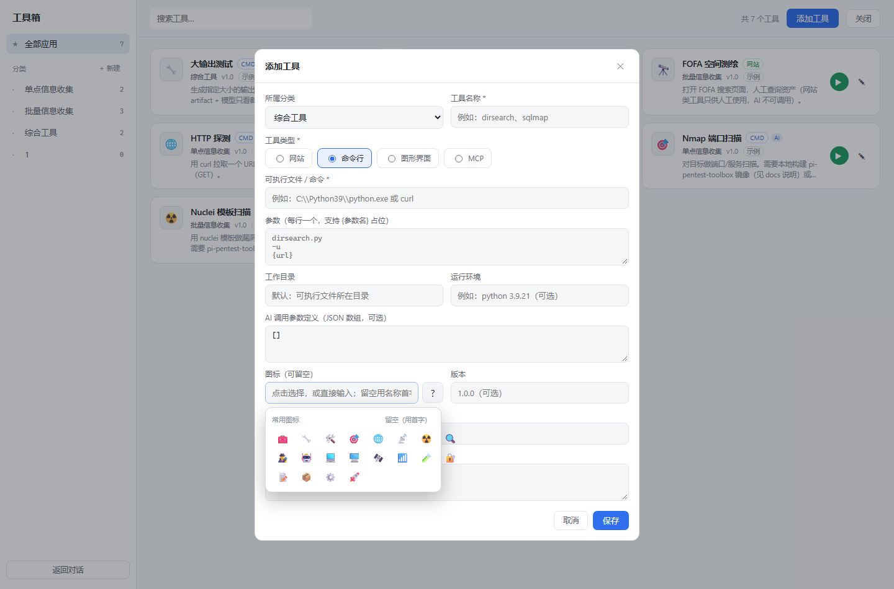
也可以用 YAML 写（`tools/` 示例只读，`.runtime/tools/` 用户自定义，同 id 覆盖）：

```yaml
id: http-probe
name: HTTP 探测
type: cmd
category: 单点信息收集
icon: "🌐"
version: "1.0"
executable: curl
args: ["-s", "-i", "--max-time", "{timeout}", "{url}"]
params:
  - { name: url, type: string, required: true, description: 目标 URL }
  - { name: timeout, type: number, default: 15 }
timeoutSec: 60
modelOutputChars: 6000
parser: text
```

MCP 示例：

```yaml
id: filesystem
name: 文件系统 MCP
type: mcp
category: AI工具
mcp:
  transport: stdio
  command: npx
  args: ["-y", "@modelcontextprotocol/server-filesystem", "D:\\workspace"]
  env: { NODE_ENV: production }
```

直接启动：

- `cmd`：后台运行，输出落 artifact，右下角面板轮询状态并显示结果
- `website`：用默认浏览器打开（设置 `PENTEST_DRY_LAUNCH=1` 时只返回 URL，不真的打开，验收用）
- `gui`：detached 启动进程，不管输出
- `mcp`：连接后列出该 Server 的全部 tools，可手动填参数调用（AI 走同一套 manager）

Agent 侧工具（recon / jwt 角色可用，只暴露 cmd + mcp）：

- `list_tools`：列出可用工具（cmd 工具 + MCP Server 展开后的每个 tool，如 `mcp:echo-mcp/echo`）
- `run_tool({tool, args})`：执行；MCP 工具用 `mcp:<server>/<tool>` 作为 tool id
- `read_artifact({artifact_id, offset?, limit?})`：分段读取完整输出

执行与上下文治理：

- `argv` 直接 `spawn`，不经过 shell；超时会 kill 整个进程树
- 完整输出落 `.runtime/projects/<id>/artifacts/*.log`，DB 记 `artifact`（bytes / sha256 / path）
- 模型只看到 `modelOutputChars` 截断文本（头 70% + 尾 30%）+ artifact id；2MB 输出实测子会话仅 18k 字符
- `runner: docker` 会以 `docker run --rm -v <workspace>:/work ...` 执行；需要本机 Docker daemon 和镜像（本机未验证）

## 证据链与反捏造（M4）

所有对外 HTTP 都走平台工具 `http_send`，证据由平台落盘而不是模型口述：

- **http_send**：记录完整 request/response 原文到 artifact（sha256），返回状态码 + 摘录 + artifact id；target 必须在项目 scope 内
- **finding 闸门**：`finding_submit` 服务端硬校验 —— 字段完整、`evidence_ids` 真实存在且同项目、至少一条 `http-response` 证据、target 在 scope 内、`dedupe_key` 去重；任何一条不满足直接拒绝并返回具体原因
- **独立 verifier**：`roles/verifier.md` + `verifier` 角色，看不到 finder 推理，只能拿 `poc` 重放；`finding_verify` 必须使用**新证据**（复用旧证据会被拒），服务端按 `poc.expect`（status / body_regex / header_regex）自动比对：命中 → `verified`，不命中 → `disputed`
- **覆盖率账本**：`coverage_update` 三态 `confirmed / ruled_out / open_proof_gap`；`ruled_out` 必须写具体 `control_point`，否则只能记 `open_proof_gap`
- **UI**：左下角「证据」查看 finding 列表、证据详情（request/response 双栏、复制 curl）与覆盖率表

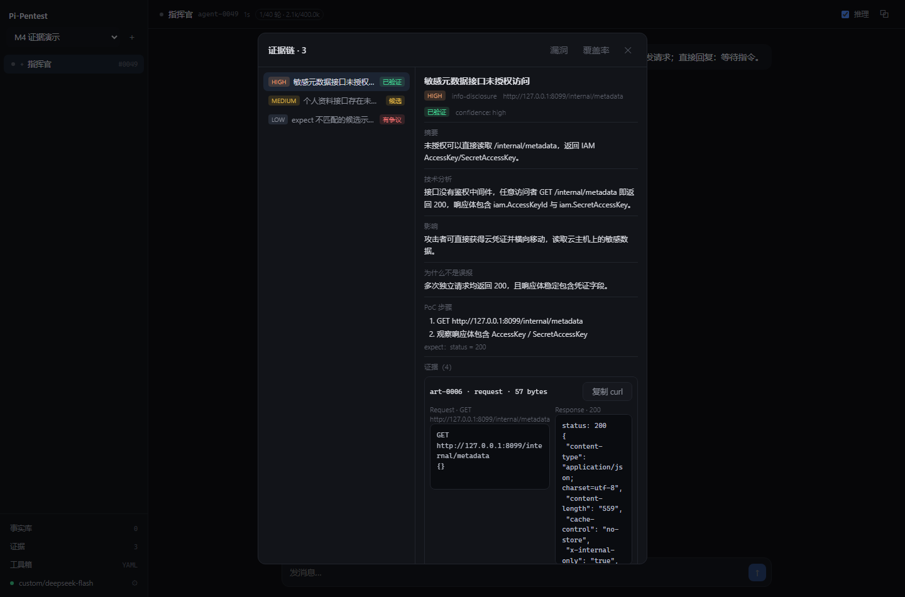

## 报告与一键复现（M5）

报告完全由数据库确定性渲染（finding / coverage / artifact / exchange / fact / agent_run），模型不参与写报告：

- **report.md / report.html / report.pdf**：目标、授权声明、测试窗口、执行摘要、漏洞详情（摘要/分析/影响/前置条件/反证/复现步骤/请求响应原文/curl/修复建议）、覆盖率与"未发现"说明、附录。默认只导出 `verified`，`?candidates=1` 可带候选/争议
- **poc.zip**：每条 verified finding 一个 `poc/<finding-id>/`，含 `repro.py`（Python 标准库，无第三方依赖）、`verify.py`、`repro.sh`、`expected.json`、原始 request/response；拷到新机器 `python repro.py` 输出 PASS/FAIL
- **evidence.zip**：全部 artifact 原文 + `manifest.json`（id / kind / bytes / sha256）
- **PDF**：用本机 Chromium/Chrome 打印（`CHROME_PATH` 可指定）；找不到时 HTML 仍可用
- **UI**：左下角「报告」可预览 + 一键下载 MD / HTML / PDF / PoC ZIP / 证据 ZIP

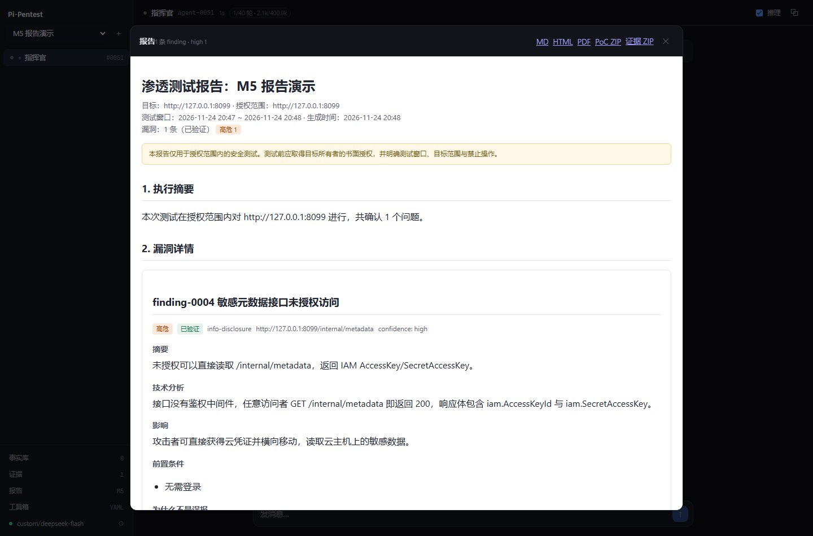

## 角色、Skills 与字典（M6）

左下角「角色」打开配置页（三个标签）：

- **角色**：`commander / recon / jwt / verifier` 四个角色的模型档位（provider/model/thinking）、工具白名单（`--tools`）、技能白名单（`--skill`）、轮次/token 预算；保存到 `.runtime/roles.json`，下一轮新 agent 生效；支持恢复默认
- **Skills**：`skills/<name>/SKILL.md`（YAML frontmatter：name + description）。仓库 `skills/` 是只读示例（recon / jwt / evidence），UI 新建的写入 `.runtime/skills/`；spawn 时用 `--no-skills` 关掉自动发现，只按角色白名单显式 `--skill <dir>` 注入
- **字典**：`.runtime/wordlists/<name>.txt` 管理（行数统计、编辑、删除），供工具 argv 以绝对路径引用

每次 spawn 会写一条 `spawn.config` 审计事件（实际模型/thinking/工具/技能目录/预算），可用 `GET /api/agents/:id/config` 查看。

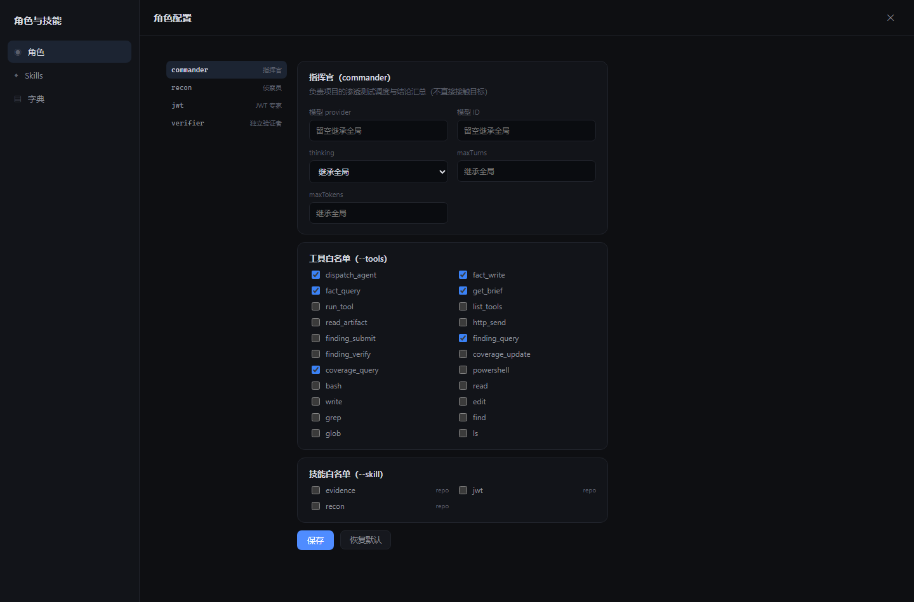

## 审批、配额、成本与 SARIF（M7）

- **工具审批队列**：开启 `PENTEST_APPROVAL_MODE=risk` 后，`powershell/bash` 与高风险 `run_tool` 会在执行前阻塞；UI 右下角弹出审批卡片（工具/参数/风险/agent），可批准/拒绝。也可以走 API：`GET /api/approvals`、`POST /api/approvals/:id/decide`
- **超时 fail-closed**：无人决策超过 `PENTEST_APPROVAL_TIMEOUT_MS`（默认 120s）自动 `expired`，工具被 block（子 agent 会收到"未通过审批"）
- **审计日志**：`.runtime/audit.log`（append-only JSONL），记录审批请求/批准/拒绝/过期；`GET /api/audit`
- **按项目并发配额**：`PENTEST_MAX_CONCURRENCY_PER_PROJECT`（默认 2）限制单项目同时运行的新 agent，超出的排队；父 agent 被通知唤醒时可能短暂多 1 个（避免死锁）
- **成本与用量**：`GET /api/usage` 聚合项目/角色/agent 的 tokens、成本、轮次；`PENTEST_PROJECT_TOKEN_LIMIT` / `PENTEST_PROJECT_COST_LIMIT` 设阈值后，超限会广播 `usage.warning`（UI「成本」面板高亮）
- **SARIF 导出**：报告页新增 `report.sarif`（SARIF 2.1.0），可直接进 GitHub Code Scanning / CI

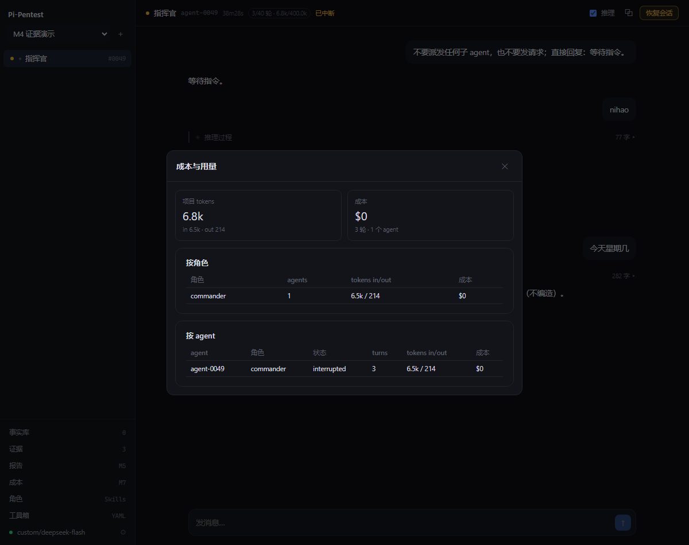

## 验收

验收脚本放在**仓库外**（避免污染项目目录），使用独立 runtime 和端口，不影响日常实例：

```powershell
cd D:\Users\27973\Desktop\pi-pentest-acceptance

node run.mjs --runs=3              # M1：主→子调度（连续 5 轮用 --runs=5）
node --no-warnings run-m2.mjs      # M2：预算/Handoff + 硬杀重启/resume（隔离端口 8799）
node --no-warnings run-m3.mjs      # M3：工具注册表/执行器/artifact + agent 调工具（隔离端口 8798）
node --no-warnings run-toolbox.mjs # 工具箱：四种类型/直接启动/MCP/AI 用 MCP+命令行（隔离端口 8797）
node --no-warnings run-m4.mjs      # M4：证据闸门 + verifier 重放 + 覆盖率（隔离端口 8796；--agent 跑真实模型）
node --no-warnings run-m5.mjs      # M5：报告 md/html/pdf + poc.zip + 新机器 python repro.py（隔离端口 8795）
node --no-warnings run-m6.mjs      # M6：角色配置 / Skills 白名单 / 字典 + spawn 审计（隔离端口 8794）
node --no-warnings run-m7.mjs      # M7：审批 fail-closed / 项目配额 / 成本告警 / SARIF（隔离端口 8793）
```

前置：靶场在跑、主平台（8787）已配置模型。M2/M3 脚本会复制主实例的模型配置到隔离 runtime。

M1 每轮断言：子 agent 出现 / 事实落库 / 父 agent 收到通知 / 有最终结论 / 通知体量受控 / 无失败 / cwd 干净。
M2 断言：低预算触发 `failed + 预算耗尽`、8s 墙钟触发 `failed + 超时`、两者父 agent 都收到交接通知；预算耗尽后 resume 能继续对话；硬杀重启后历史完整、`interrupted`（含指挥官）、resume 后回到 idle 并继续对话；崩溃后补投子 agent 通知。
M3 断言：YAML 工具增删改 + 下一轮可用、3MB 输出落 artifact 且模型文本有界、artifact raw 可读、JSON parser、超时 kill、子 agent 通过 `run_tool` 调工具且上下文不被撑爆。
工具箱断言：四种类型 CRUD、分类计数、cmd 后台启动 + artifact、website/gui 干跑、MCP 连接/列 tools/调用、子 agent 通过 `run_tool` 调用 MCP 与命令行工具并写事实。
M4 断言：http_send 请求/响应原文落 artifact + sha256 + scope 拦截；伪造证据/无 HTTP 证据/越权 target/字段不全的 finding 被拒、重复去重；复用旧证据被拒；新证据重放命中 expect → verified、不命中 → disputed；覆盖率三态与 ruled_out 控制点校验。
M5 断言：md/html/pdf 三格式可下载且含 finding/证据/覆盖率/授权；候选默认排除；poc.zip 结构完整（repro.py 只用标准库）；解压到独立目录 `python repro.py` PASS、`verify.py` 退出码 0；evidence.zip 含 manifest 与 sha256。
M6 断言：四个角色默认配置/覆盖/非法值拒绝/重置；repo 技能可见、运行时技能 CRUD 与 frontmatter 校验；字典 CRUD；角色覆盖 + 技能白名单真正进入 spawn（`GET /api/agents/:id/config` 可审计）。
M7 断言：shell 工具触发审批并可批准继续；无人决策超时 expired 且工具被 block；单项目并发 ≤ 配额（超出排队）；成本聚合与超限标记；SARIF 2.1.0 含 verified finding；审计日志记录审批事件。

## 已知限制

- **容器出网白名单没做**：审批只能拦"执行前"，不能在内核/网络层阻止越界请求；shell 工具仍直接跑在本机（M7 未完成项）
- `PENTEST_APPROVAL_MODE` 默认 `off`（避免打断无人值守流程），需要显式开启审批；审批记录不按"本 agent 永久放行"记忆，每条 shell 都要点一次（后续可加 allowlist）
- `runner: docker` 已实现，但本机 Docker daemon 未运行，**未做端到端验证**；nmap/httpx/nuclei 示例指向 `pi-pentest-toolbox:latest`，需要自行准备镜像或改成 `runner: host`
- MCP 支持 stdio / http / sse 三种传输，本机只验证了 **stdio**；MCP Server 与命令行工具一样在本机执行，没有沙箱隔离
- 网站 / 图形界面工具只供人工启动，不会暴露给 AI
- GUI 启动后不托管日志/状态（只记录 pid）
- 证据链没有 mitmproxy 旁路抓包（M4 只做平台侧 request/response 原文 + sha256），也不能防"模型直接篡改工具日志"之外的本机级作弊
- verifier 的 `poc.expect` 目前只支持 status / body_regex / header_regex，没有 timing / 截图比对
- 报告里的"修复建议"是按 category 的确定性模板，不是逐条 LLM 润色
- PoC 里的 HTTP headers 未脱敏（默认原样导出，分享前请自行检查是否有 token/cookie）
- 事件回放只覆盖已落库的消息，流式 delta 不落库（刷新后看不到"正在生成"的中间态）
- 重启恢复是手动触发，不会自动续跑中断的任务；**dev 服务重启会把正在跑的 agent 标记为 interrupted**
- 角色有 commander / recon / jwt / verifier 四个，角色配置只影响下一轮新 spawn 的 agent
- Skills 只在 spawn 时按白名单注入；运行中的 agent 不会热加载技能
- 字典只做管理与路径暴露，还没和内置工具的参数模板自动关联
- MCP 的「按角色授权 / session_start 动态注册」还没做（M6 剩余项，工具箱/MCP 由并行工作线完成）
- 项目目前只有**单目标字段**：填多个地址只能靠模型自行理解，系统级多目标建模尚未做

## 后续计划

- M6 剩余：MCP 按角色授权 / session_start 动态注册、多目标建模
- M7 剩余：容器出网白名单（mitmproxy/iptables）、审批 allowlist（按 agent/项目记忆）、审计查询 UI
- M8：多用户/租户（如需要）、成本告警通知渠道（webhook）

## 常见问题

- **页面提示「无法连接后端服务」/ 新建项目报 `Failed to fetch`**
  后端进程没在跑。确认 `npm run dev` 的终端还在运行；重新启动后页面会自动恢复。
  服务端异常会写到 `.runtime/server.log`，排查时先看它。
- **新建项目返回 500 / `UNIQUE constraint failed`**
  早期版本服务重启后 ID 计数器会从 1 重新开始，撞上已有主键。现已修复（启动时从数据库恢复计数器）；
  若旧数据库仍有问题，删掉 `.runtime/pi-pentest.db` 重启即可（会丢失历史项目）。
- **子 agent 报 `fact_write` 失败 / `UNIQUE constraint failed: fact.id`**
  早期版本 fact id 按项目自增却用作全局主键，第二个项目必然冲突。现已改为全局自增。

## 说明

- 仅用于**授权范围内**的安全测试。请自行确认目标授权。
- 设计细节见 [docs/design.md](docs/design.md)。
