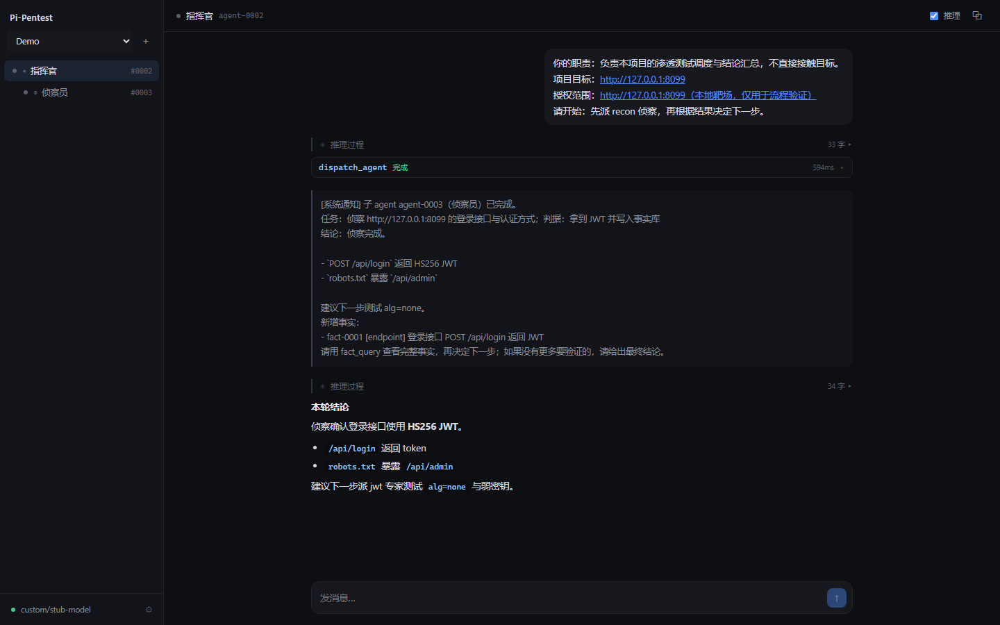
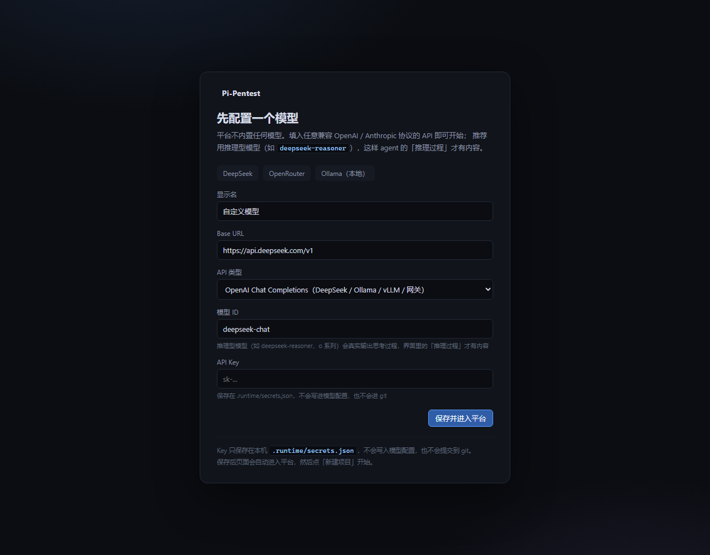

# Pi-Pentest

基于 [pi](https://github.com/earendil-works/pi) 框架的多 Agent 渗透测试平台（最小可用 demo）

一个 **主 Agent** 负责判断与调度，把任务派给 **子 Agent**（各自是独立的 pi 进程、独立会话、独立上下文）；
所有 Agent 共享一个项目事实库；WebUI 可以看每个 Agent 的会话、推理过程和工具调用，并用自然语言直接对话。



## 功能

- **主 → 子调度**：主 Agent 通过 `dispatch_agent` 派发结构化任务书（目标 / 假设 / 判据 / 事实引用）
- **子 Agent 独立会话**：独立进程、独立 session 文件、不继承父会话上下文
- **结论回流**：子 Agent 结束后，平台把结论与新增事实压缩成 `[系统通知]` 唤醒父 Agent
- **共享事实库**：SQLite，`fact_write` / `fact_query`，所有 Agent 可见
- **推理可见**：推理型模型的 thinking 流式渲染，默认折叠
- **自然语言对话**：任意 Agent 都能接手对话；空闲时是新 prompt，运行中是 steer 旁注
- **独立窗口**：子 Agent 可弹出单独窗口
- **模型自带**：不内置任何模型，首次启动填写自己的 API

## 环境要求

- Node.js ≥ 22.19
- [pi CLI](https://github.com/earendil-works/pi)（平台用 `pi --mode rpc` 驱动 Agent）
  ```powershell
  powershell -c "irm https://pi.dev/install.ps1 | iex"
  ```
- 一个兼容 OpenAI / Anthropic 协议的模型 API（DeepSeek、OpenRouter、Ollama、Anthropic 等）

## 快速开始

```bash
npm install
npm run dev
```

- WebUI： http://127.0.0.1:5173
- API/编排： http://127.0.0.1:8787

第一次打开会要求配置模型：



填 Base URL / API 类型 / 模型 ID / API Key，保存后 **新建项目**，目标填你自己的授权目标
（本地可先起一个 Juice Shop / DVWA 之类的靶场验证流程）。

生产模式（不用 Vite）：

```bash
npm run build
npm start          # http://127.0.0.1:8787
```

## 模型配置

| Provider | Base URL | API 类型 | 模型 ID |
|---|---|---|---|
| DeepSeek | `https://api.deepseek.com/v1` | openai-completions | `deepseek-chat` / `deepseek-reasoner` |
| OpenRouter | `https://openrouter.ai/api/v1` | openai-completions | 任意模型 ID |
| Ollama | `http://127.0.0.1:11434/v1` | openai-completions | 本地已 pull 的模型 |
| Anthropic | `https://api.anthropic.com` | anthropic-messages | `claude-sonnet-4-5` |

想看到「推理过程」就用推理型模型（`deepseek-reasoner`、o 系列等）。

API key 存在 `.runtime/secrets.json`，不写进模型配置，也不会提交到 git。

## 架构

```
WebUI (React)
   │ REST + SSE
   ▼
apps/server  ── supervisor ──> 每个 agent 一个 `pi --mode rpc` 子进程
   │  调度 / 事件归一化 / 唤醒 / 用户对话        │
   │                                          └─ pi-kit 扩展：dispatch_agent / fact_* / brief 注入
   ▼
SQLite (.runtime/pi-pentest.db)  project / agent_run / agent_event / fact
```

| 目录 | 说明 |
|---|---|
| `apps/server` | HTTP + SSE + 内部 API + Agent 调度器 |
| `apps/web` | React + Vite 极简 WebUI |
| `packages/agent-runtime` | pi RPC 客户端（spawn / JSONL / 事件 / 中止） |
| `packages/db` | node:sqlite 领域库 |
| `packages/pi-kit` | 唯一的 pi 扩展：业务工具 + 钩子 |
| `roles/` | commander / recon / jwt 三个角色提示词 |
| `scripts/dev.mjs` | 同时启动 server 与 Vite |
| `docs/` | 截图与设计说明 |

运行时数据都在 `.runtime/`（已 gitignore）：模型配置、secrets、SQLite、每个 Agent 的 pi 会话 JSONL、钩子日志。

## 已知限制

这是 M1 demo，以下尚未实现：

- 服务重启后 Agent 子进程不恢复（历史可查看，不能继续对话）
- 没有审批弹窗与 scope 拦截，Agent 的 shell 工具直接跑在本机
- 没有工具容器化、证据链、报告导出
- 单项目并发无配额控制

## 后续计划

- M2：会话恢复、预算/超时/级联中止、审批弹窗
- M3：工具容器化、工具注册表、MCP 管理
- M4：证据链与可复现报告

## 说明

- 仅用于**授权范围内**的安全测试。请自行确认目标授权。
- 设计细节见 [docs/design.md](docs/design.md)。
